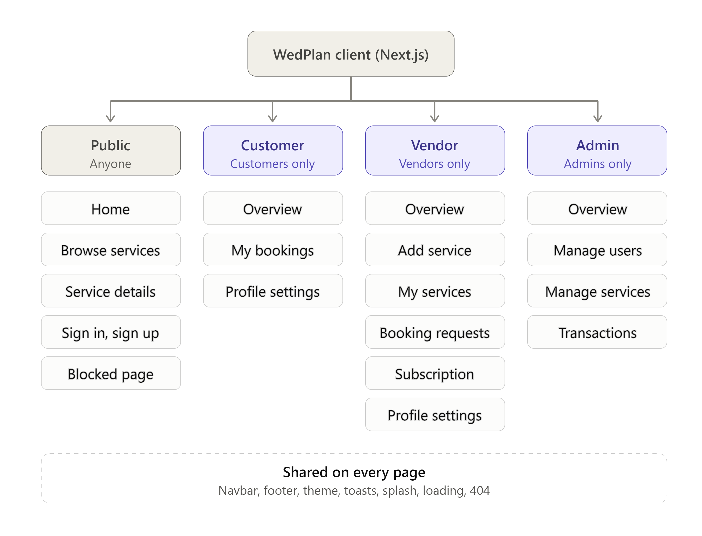
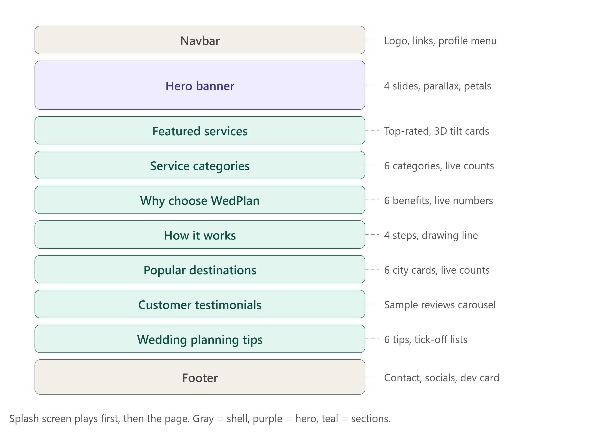
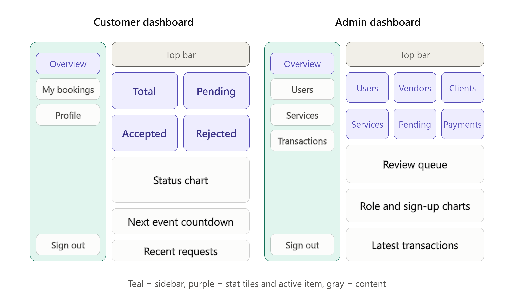
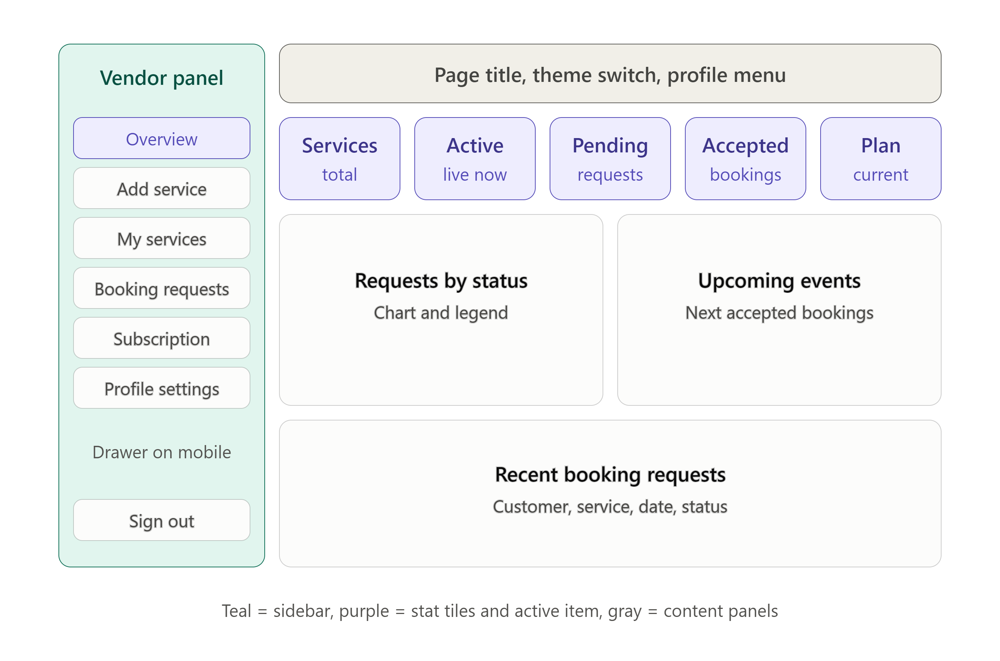
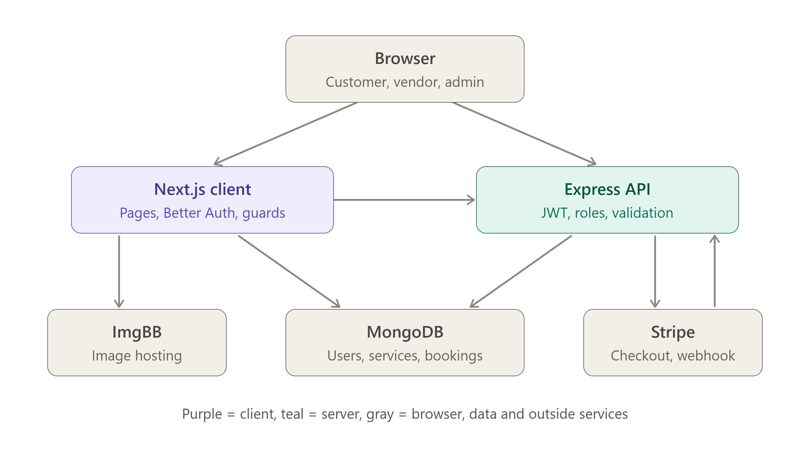
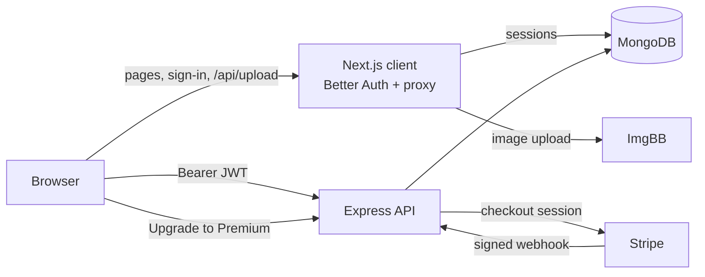

# 💍 WedPlan

> A role-based wedding planning platform for **customers, vendors and admins**


<!-- [**Live Website**](https://sofian-wedplan.vercel.app/) · [**Client Repository**](https://github.com/marleyDip/Programming-Hero_A-09_Wedding-Planning-Platform_NextJS-TS-betterAuth-Shadcn-Motion_Milestone-09_M-55) · [**Server Repository**](https://github.com/marleyDip/PH_A-09_Wedding-Planning-Platform_ExpressJS-TypeScript-MongoDB-Stripe-BetterAuthJWT_Milestone-9_M-55) -->

[](https://sofian-wedplan.vercel.app/)

[](https://github.com/marleyDip/Programming-Hero_A-09_Wedding-Planning-Platform_NextJS-TS-betterAuth-Shadcn-Motion_Milestone-09_M-55)

[](https://github.com/marleyDip/PH_A-09_Wedding-Planning-Platform_ExpressJS-TypeScript-MongoDB-Stripe-BetterAuthJWT_Milestone-9_M-55)

---

## System Design & Architecture












---

## Table of contents

1. [Project name and description](#1-project-name-and-description)
2. [Links](#2-links)
3. [Important features](#3-important-features)
4. [Technology stack](#4-technology-stack)
5. [How it works](#5-how-it-works)
6. [Installation instructions](#6-installation-instructions)
7. [How to run the project locally](#7-how-to-run-the-project-locally)
8. [Routes and access control](#8-routes-and-access-control)
9. [Project structure](#9-project-structure)
10. [Security](#10-security)
11. [Deployment](#11-deployment)
<!-- 12. [Project status](#12-project-status) -->

---

## 1. Project name and description

**WedPlan** is a wedding planning platform where couples discover wedding services and send booking requests to vendors.

- **Customers** browse and filter services, view details, send booking requests and track or cancel them.
- **Vendors** create a business profile, publish wedding services, accept or reject booking requests and can upgrade to **Premium** for unlimited services and a Premium Vendor badge.
- **Admins** manage registered users, review and moderate every submitted service and monitor platform transactions.

This repository is the **client** (Next.js). The REST API, MongoDB access and the Stripe webhook live in the separate **server** repository.

## 2. Links

## 🔗 Project Links

| Platform | Link |
| :--- | :--- |
| 🌐 **Live Website** | [Visit WedPlan](https://sofian-wedplan.vercel.app/) |
| 💻 **Client Repository (This Repo)** | [View Client Repository](https://github.com/marleyDip/Programming-Hero_A-09_Wedding-Planning-Platform_NextJS-TS-betterAuth-Shadcn-Motion_Milestone-09-M-55) |
| 🖥️ **Server Repository** | [View Server Repository](https://github.com/marleyDip/PH_A-09_Wedding-Planning-Platform_ExpressJS-TypeScript-MongoDB-Stripe-BetterAuthJWT_Milestone-9_M-55) |

### Evaluation access

| Role | Email | Password |
| --- | --- | --- |
| Admin | `wedplan.admin@gmail.com` | `Aa123456` |

Admin accounts cannot be created through public sign-up; admin access is assigned securely on the server. Customers and vendors can register on the Sign Up page or continue with Google.

<!-- Replace every <PLACEHOLDER> above before submitting. -->

## 3. Important features

### 🏠 Public website

| Feature | Details |
| --- | --- |
| **Animated 3D splash screen** | Branded intro with the WedPlan logo, then the site |
| **Hero banner** | 4 slides with autoplay and progress bars, keyboard and swipe controls, mouse parallax, floating glass card, falling petals, headline reveal and a **"Explore Wedding Services"** call to action. Respects reduced-motion |
| **Featured Wedding Services** | Top-rated services from the database (approved and active only), 3D tilt cards with image, name, category, price, location, vendor and **View Details** |
| **Wedding Service Categories** | The six categories (Photography & Videography, Wedding Venues, Decoration & Florist, Catering Services, Makeup & Styling, Wedding Fashion) with live service counts. Each one opens Browse Services pre-filtered |
| **Why Choose WedPlan?** | Six benefit cards and live platform numbers (services, vendors, cities, categories) taken from real data |
| **How WedPlan Works** | Four steps joined by a connector that draws itself on scroll, each with a mini live preview |
| **Popular Wedding Destinations** | Six city cards with illustrated landscapes and a live service count; each links to a filtered Browse page |
| **Customer Testimonials** | Animated testimonial carousel (sample content, clearly labelled until real reviews are added) |
| **Wedding Planning Tips** | Six-step planning timeline with tick-off checklists and links to matching categories |
| **Navbar** | Logo, role-aware links, profile dropdown (name, photo, Dashboard, Profile Settings, Logout) that updates the moment auth state changes |
| **Footer** | Logo and description, navigation, contact information, social links, copyright and an animated developer card |
| **Light and dark theme** | Rose-gold design system built on CSS variables, switchable from the navbar |
| **Custom loading and 404 pages** | Branded loader and a helpful "page not found" screen |

### 🔎 Browse Services

- Live **at-a-glance analytics**: stat tiles, services-per-category bar chart and services-per-city donut. Click a bar or slice to filter
- **Search** by service name, **category** and **location** filters, and **price sorting** (ascending and descending) with custom 3D dropdowns
- Active-filter chips, live result count and reset. Filters live in the URL (`?q=&category=&location=&sort=`), so filtered pages can be shared
- Responsive 3D cards, loading skeletons, error with retry, and an empty state
- Only **approved and active** services are shown

### 📄 Service Details

- Private route `/services/[id]`: signed-out visitors are sent to Sign In and return afterwards
- Photo gallery with flip transitions and lightbox, category, description, price, location and vendor information
- **Booking form**: event date, event location and message. Customer and vendor are identified automatically
- Rules: no past dates, no duplicate active request for the same service and date, vendors cannot book their own service, admins and blocked users cannot book
- Clear states for an invalid service ID and for a service that isn't available

### 🔐 Authentication

- Sign Up and Sign In with **email and password** or **Google**
- Role selection (**Customer** or **Vendor**; vendors also give a business name), including for Google sign-up
- Password rules: 6+ characters, one uppercase, one lowercase, with live feedback
- Optional **profile image upload** (ImgBB) with drag and drop, progress ring and retry
- Redirects by role after sign-in, success and error toasts
- Admin accounts can never be created from the public form

### 👤 Customer dashboard

- **Overview:** total, pending, accepted and rejected requests, a status chart, next-event countdown and recent requests
- **My Bookings:** service name and image, vendor, event date and location, status and request date; filter, sort, **view details** with a timeline, and **cancel pending requests** only (with confirmation)
- **Profile Settings:** update name, photo and contact details; role and subscription can't be changed

### 🏪 Vendor dashboard

- **Overview:** total services, active services, pending requests, accepted bookings and current plan, with charts and upcoming events
- **Add Service:** name, category, description, price, location and up to four uploaded photos, with a **live preview** (browse card and details page) and a completeness meter. New services start as **Pending**
- **My Services:** status tabs, search and sort, view details, edit, delete, **availability switch** and approval status. Rejected services are hidden from customers
- **Booking Requests:** customer, service, event date, location, message and status; **accept or reject** pending requests only (with confirmation), date-conflict warning
- **Subscription:** Free vs Premium plans, usage meter, **Upgrade to Premium** through Stripe Checkout, and a refresh-status button
- **Profile Settings:** name, photo, business name, phone and address, with a live "how customers see you" preview
- **Free plan:** up to 3 active services. **Premium:** unlimited services and a Premium Vendor badge

### 🛡️ Admin dashboard

- **Overview:** total users, vendors, customers, services, pending services and transactions, plus a review queue, sign-up chart and latest payments
- **Manage Users:** search by name or email, filter by role, view details, **block and unblock** (admins and yourself can't be blocked)
- **Manage Services:** view all submitted services, search and filter, review pending ones, **approve, reject**, change the status of published services, **delete** inappropriate ones (with undo for status changes)
- **Transactions:** vendor, plan, amount, status and date. **Read-only**: payment records can't be edited from the dashboard

### ⚙️ Platform and quality

- **Role-based dashboards** with a collapsible sidebar, tooltips, mobile drawer and live badges
- **Protected routes:** signed-out users go to Sign In, users can't open another role's dashboard by editing the URL, blocked users see a "blocked" page
- **JWT** attached to every protected API request
- Fully **responsive** (mobile, tablet, desktop), keyboard accessible, `prefers-reduced-motion` respected
- **Toast notifications** (no `alert()`), loading skeletons and clear error and empty states throughout
- Unsaved-changes warnings on long forms, optimistic updates with rollback on failure

## 4. Technology stack

| Layer | Technology |
| --- | --- |
| Framework | **Next.js** (App Router), **React**, **TypeScript** |
| Styling | **Tailwind CSS v4** with CSS-variable theming, `next-themes` for dark mode |
| Animation | **Framer Motion** (springs, 3D tilt, shared-layout transitions, scroll-linked effects) |
| Icons and feedback | Lucide React, **Sonner** toasts |
| Authentication | **Better Auth** (email and password, Google OAuth, JWT plugin) |
| Database (auth) | **MongoDB** through the Better Auth adapter |
| Payments | **Stripe Checkout** (test mode); Premium activated only by a verified webhook |
| Image hosting | **ImgBB**, uploaded through a server-side Next.js route |
| Backend (separate repo) | **Node.js, Express, TypeScript, MongoDB** |

## 5. How it works



1. A user signs in through Better Auth, which sets the session cookie and issues a JWT.
2. The client sends that JWT to the Express API; the server verifies it and checks the user's role and blocked status in the database.
3. A vendor's service starts as **pending**; an admin approves it, and only then does it appear on the public pages.
4. A customer sends a booking request; the vendor accepts or rejects it once.
5. A vendor upgrades through Stripe Checkout; **only Stripe's signed webhook** switches Premium on.

## 6. Installation instructions

**Requirements:** Node.js 20 or newer, npm, a MongoDB database, and the **server** running (see the server repository's README).

```bash
# 1. Clone the client
git clone <CLIENT_REPO_URL>
cd <client-folder>

# 2. Install dependencies
npm install
```

### Environment variables

Create a `.env.local` file in the project root. **Never commit it**; `.env*` files are git-ignored.

```env
# Express API (the server repository)
NEXT_PUBLIC_API_URL=http://localhost:5000

# Better Auth: the URL this site is served from
BETTER_AUTH_URL=http://localhost:3000
NEXT_PUBLIC_AUTH_URL=http://localhost:3000
BETTER_AUTH_SECRET=<long random string>

# MongoDB (same database the server uses)
MONGODB_URI=<your MongoDB connection string>

# Google OAuth
GOOGLE_CLIENT_ID=<from Google Cloud Console>
GOOGLE_CLIENT_SECRET=<from Google Cloud Console>

# ImgBB image hosting
IMGBB_API_KEY=<from https://api.imgbb.com>

# Optional: text shown on the Premium plan card, for example "999 / month"
NEXT_PUBLIC_PREMIUM_PRICE_LABEL=
```

| Variable | Purpose |
| --- | --- |
| `NEXT_PUBLIC_API_URL` | Base URL of the Express API |
| `BETTER_AUTH_URL` / `NEXT_PUBLIC_AUTH_URL` | Public URL of this site. The server's `BETTER_AUTH_URL` must match it exactly |
| `BETTER_AUTH_SECRET` | Signs sessions. Generate with `openssl rand -base64 32` |
| `MONGODB_URI` | MongoDB connection string |
| `GOOGLE_CLIENT_ID` / `GOOGLE_CLIENT_SECRET` | Google sign-in. Add `<BETTER_AUTH_URL>/api/auth/callback/google` as an authorised redirect URI |
| `IMGBB_API_KEY` | Profile and service photo uploads (kept server-side) |
| `NEXT_PUBLIC_PREMIUM_PRICE_LABEL` | Optional display price; nothing is shown when empty |

Stripe keys and the webhook secret belong **only on the server**.

## 7. How to run the project locally

```bash
# Terminal 1: the server (in the server repository)
npm run dev                 # http://localhost:5000

# Terminal 2: the client (this repository)
npm run dev                 # http://localhost:3000
```

| Script | What it does |
| --- | --- |
| `npm run dev` | Development server with hot reload |
| `npm run build` | Production build |
| `npm start` | Serve the production build |
| `npm run lint` | Run ESLint |

### Try every role

1. **Customer and vendor:** register two accounts on `/signup` (use a private window for the second).
2. **Admin:** on the server run `npm run make-admin -- you@example.com`, then sign in with that account.
3. **Vendor:** add a service in *Add Service*. It starts as **Pending**.
4. **Admin:** approve it in *Manage Services*. It now shows on Browse Services.
5. **Customer:** open the service and send a booking request.
6. **Vendor:** accept or reject it in *Booking Requests*.
7. **Vendor:** open *Subscription* and upgrade with the Stripe test card `4242 4242 4242 4242`. Premium turns on after Stripe's webhook reaches the server (for local testing, forward it with the Stripe CLI as described in the server README).

## 8. Routes and access control

| Route | Access |
| --- | --- |
| `/`, `/services`, `/signin`, `/signup` | Public |
| `/services/[id]` | Signed-in users (others are redirected to Sign In) |
| `/dashboard` | Redirects to your own dashboard |
| `/dashboard/customer` · `/bookings` · `/profile` | Customers only |
| `/dashboard/vendor` · `/services` · `/services/new` · `/services/[id]/edit` · `/bookings` · `/subscription` · `/profile` | Vendors only |
| `/dashboard/admin` · `/users` · `/services` · `/transactions` | Admins only |
| `/blocked` | Shown to blocked accounts |

## 9. Project structure

```text
app/
├─ page.tsx · loading.tsx · not-found.tsx
├─ signin/ · signup/ · blocked/
├─ services/            (browse)  and  services/[id]/ (details)
└─ dashboard/
   ├─ page.tsx          role redirect
   ├─ customer/ · vendor/ · admin/   (each with its own layout and route guard)
components/
├─ home/                hero, featured services, categories, why choose, how it works,
│                       destinations, testimonials, planning tips, section kit
├─ services/            services explorer, service details
├─ dashboard/
│  ├─ dashboard-shell.tsx   shared sidebar layout
│  ├─ customer/ · vendor/ · admin/
├─ auth/                auth UI, image uploader, sign-out button
├─ ui/                  custom select and shared UI
├─ navbar.tsx · footer.tsx · logo.tsx · splash-screen.tsx
lib/
├─ auth.ts · auth-client.ts · session.ts
├─ services-api.ts · bookings-api.ts · vendor-api.ts · admin-api.ts
proxy.ts                signed-in check for private routes
```

## 10. Security

- **Server-side role checks.** Every protected API verifies the JWT and the user's role and blocked status from the database. Hidden links are never relied on.
- **Route protection** in three layers: a `proxy`/middleware check, a server-side role check in each dashboard layout, and the API itself.
- **Secrets stay in environment variables:** Better Auth secret, MongoDB URI, Google OAuth credentials, ImgBB key and Stripe keys. `.env` files are never committed.
- **Users can't change their own role** or subscription through profile updates, and admins can't be created through sign-up.
- **Premium is activated only by a verified Stripe webhook**, never by the success redirect.
- **Payment records are read-only.** Nobody can mark a payment as successful by hand.

## 11. Deployment

1. Set all the environment variables above in your hosting dashboard, using your live URLs for `BETTER_AUTH_URL`, `NEXT_PUBLIC_AUTH_URL` and `NEXT_PUBLIC_API_URL`.
2. On the server, add the live site origin to `CLIENT_URL` (CORS and Stripe redirects), and register the Stripe webhook at `<API_URL>/payments/webhook`.
3. Add the live Google redirect URI in Google Cloud Console.
4. After deploying, check that refreshing any private route keeps you signed in, and that sign-in, booking, Stripe Checkout and the webhook all work on the live site.

<!-- ## 12. Project status

- **Payment Success and Payment Cancel pages** (Stripe redirect targets) are not part of this repository yet.
- Customer testimonials on the home page are **sample content** and are labelled as such until real reviews exist. -->

---

## 👨‍💻 Author

### ✨ Md. Sofian Hasan ✨

> Software Engineer | Full-Stack (MERN / PERN) Developer

[](https://marleydip.netlify.app/)
&nbsp;
[](https://github.com/marleyDip)

Passionate about building **modern, scalable, and user-focused web applications** while continuously strengthening ***JavaScript, TypeScript, problem-solving, and full-stack development skills***.

### 🚀 Tech Focus


---

## 📄 License

This project is developed for educational and learning purposes. You may adapt and extend it according to your requirements.

---

## 🙏 Acknowledgements & Learning Credits

### Special Thanks to Programming Hero

This project was developed as part of my learning journey through the **AI-Driven Full Stack Web Engineering Course Level-1 Batch-14**.

I would like to express my sincere gratitude to the entire **Programming Hero team, instructors, mentors, and community** for providing structured learning resources, practical guidance, and an encouraging environment to grow as a developer.

Throughout this journey, I have had the opportunity to strengthen my understanding of modern web development concepts, explore full-stack application architecture, and apply my knowledge by building real-world projects.

**WedPlan represents more than just a course assignment - it is an opportunity to transform the concepts I have learned into a practical, functional application.**

Special thanks for inspiring me to keep learning, experimenting, solving problems, and building better software.

**Learning never stops. Every project is another step forward.** 🚀

[](https://codelab.programming-hero.com/u/marleydip)
